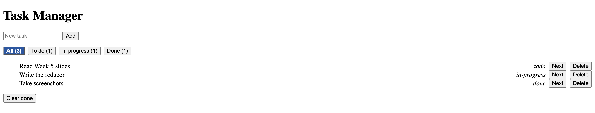
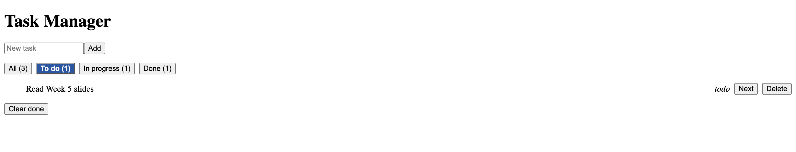
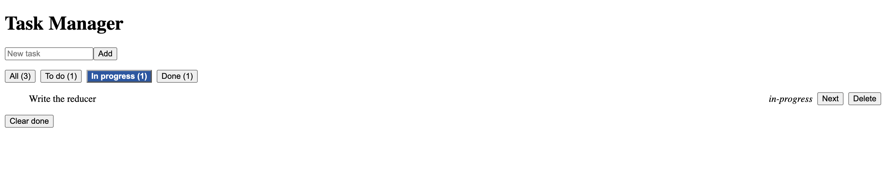
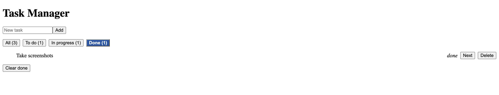

# Assignment 3: Task Manager with a Reducer

**Name:** Doruk Şahin
**Student number:** 2023502030

MIS 233 Web Based Application Programming, Fall 2026, Week 5.

## How to run

Needs Node.js 20.19 or newer.

```
npm install
npm run dev       # open the address it prints
npm run build     # type check (strict) and build
npm test          # run the tests (Bonus 2)
```

## What is in the project

- `src/taskReducer.ts`: `State`, `Action`, `initialState` and the pure `taskReducer`.
  The state is `{ tasks, filter, past }`. The actions are `add`, `advance`, `remove`,
  `setFilter`, `clearDone` and `undo`.
- `src/filter.ts`: the pure functions `filterTasks` and `countByFilter` (no React).
- `src/App.tsx`: keeps the state with `useReducer` and passes it down as props to
  `AddForm`, `FilterBar` and `TaskList`. The visible list and the counts are derived
  while rendering and are not stored in state.
- `src/TaskRow.tsx`: one row with the title, the status, Next and Delete.
- `screenshots/`: the four filters.

## Screenshots

| Filter | Screenshot |
| --- | --- |
| All |  |
| To do |  |
| In progress |  |
| Done |  |

## Bonus 1: Undo

The state is now `{ tasks: Task[]; filter: Filter; past: Task[][] }`. `past` keeps the
earlier task lists, the newest one last: every action that changes `tasks` (`add`,
`advance`, `remove`, `clearDone`) pushes the old list onto `past`, and `undo` takes the
last list back and removes it from `past`. `setFilter` does not touch `past`, so changing
the filter is not undoable, and the Undo button is disabled when `past` is empty.

## Bonus 2: Tests

The tests use Vitest and are in `src/taskReducer.test.ts` and `src/filter.test.ts`.
They cover every action (and `advance` three times returning to `todo`), check that the
old state is not changed (the state is frozen with `Object.freeze` and compared with a
copy after each call), test `filterTasks` and `countByFilter`, and the edge cases: an
unknown id, an empty list, `clearDone` with nothing done, counts after a delete, and undo.

Output of `npm test`:

```
> task-manager-assignment3@0.0.0 test
> vitest run

 RUN  v5.1.1 /Users/doruksahin/Desktop/assignment3

 ✓ src/filter.test.ts (6 tests) 2ms
 ✓ src/taskReducer.test.ts (14 tests) 3ms

 Test Files  2 passed (2)
      Tests  20 passed (20)
   Start at  13:05:04
   Duration  86ms (transform 62%, import 22%, tests 10%, worker 6%)
```
